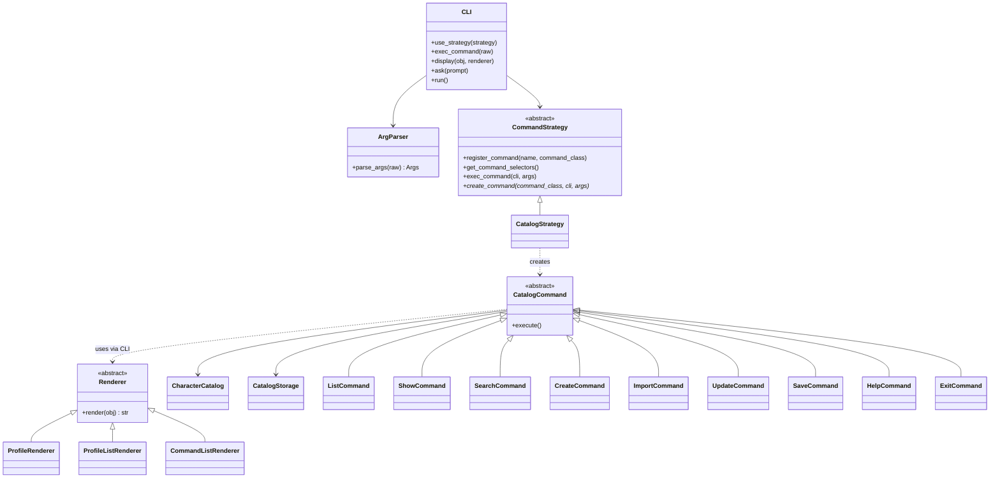
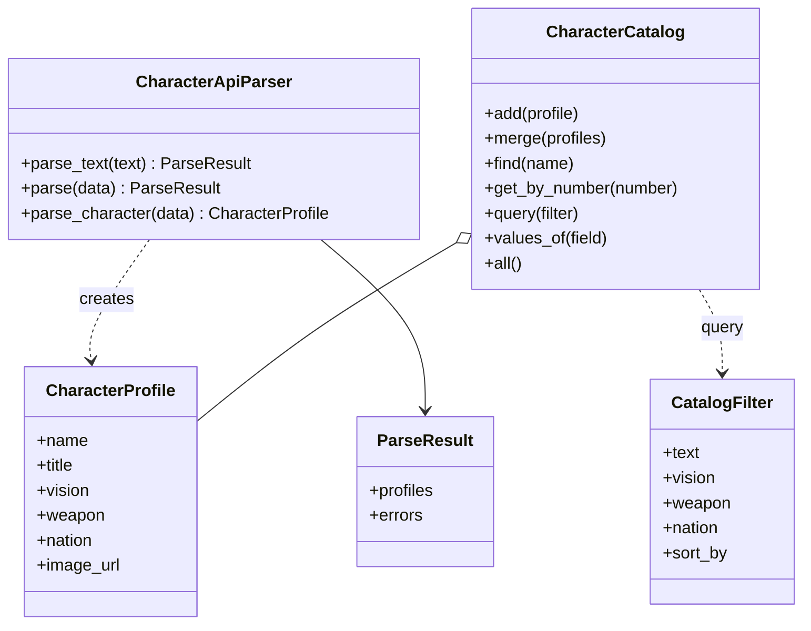
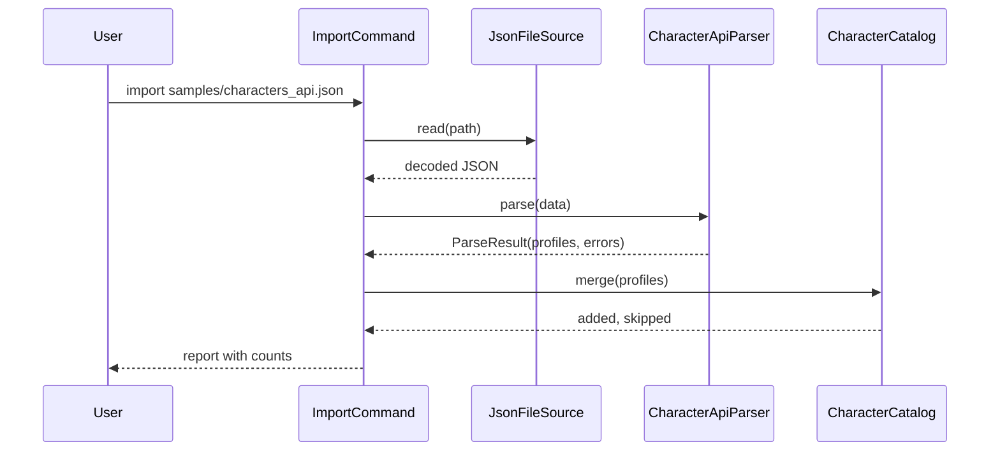

# Design Document: Character Catalog

| | |
|---|---|
| **Author** | Dariia Voitenko, group KN-31, Optima College |
| **Course** | Object-Oriented Programming, Practicals 13 and 14 |
| **Topic** | Topic 1: Character Catalog |
| **Status** | Implemented |

## 1. Introduction

The project is a console application that keeps a catalog of game characters.
A user can list and search characters, look at one character in detail (including a link
to its artwork), create a character through a dialog, import characters from a JSON file
in the format of the game API, and save the catalog to disk.

This document describes the structure of the whole application. Two parts are described
in detail:

- the **command line interface** (User Interface category, Practical 13);
- the **business logic** (Core category, Practical 14): parsing of the API data,
  the catalog rules, and the interface that a future graphical UI will use.

## 2. Goals and Non-Goals

**Goals**

- Parse the JSON that the character API returns into objects of our own model.
- Prepare the data for a graphical interface: searching, filtering, sorting and
  lists of available filter values.
- Show the list of characters and a character card with a link to its graphics.
- Create a character through a dialog and save user data between runs.
- Keep the core independent of the console, files and the network, so that the CLI and a
  future GUI can share it.

**Non-goals**

- The graphical interface itself (a later layer, see Rollout Plan).
- Loading data from the remote server in this version (the server is unavailable, see Constraints).
- Multi-user access or a database.

## 3. Assumptions

- A single user works with the application at a time.
- The catalog is small (tens of characters), so it lives in memory.
- JSON serialization is enough for persistence (as taught in the course).
- Python 3.9 or newer is installed.

## 4. Constraints and Limitations

- The remote service `genshin.jmp.blue` returned `HTTP 521 (Web server is down)` on
  2026-10-30 and again on 2026-11-11. Its responses could not be inspected, so the parser
  is designed from the fields used in earlier practicals (`name`, `title`, `vision`,
  `weapon`, `nation`) and is deliberately tolerant: unknown fields are ignored and every
  field except `name` is optional. The sample file `samples/characters_api.json` imitates
  the API format and lets the parser be exercised without the network.
- The catalog ships with a built-in starter set of characters (stubs), which the
  assignment explicitly allows. Image links point to the same service and open only when
  it is back online.
- Character names are unique (case-insensitive, extra spaces ignored).
- The terminal must support UTF-8 and box-drawing characters.

## 5. Potential Solutions

| Option | Description | Decision |
|---|---|---|
| A | Put all logic into one `main` function with an `if/elif` chain | Rejected: hard to test and to extend |
| B | Layered application: CLI facade, framework-free core, separate persistence | **Chosen** |
| C | Load characters from the remote API on every start | Rejected for now: the server is down; it will reuse the same parser later |

For the parser two shapes were considered: a function that returns raw dictionaries, or a
class that returns validated model objects. The second was chosen because every layer above
then works with `CharacterProfile` only and never with the shape of the server response.

## 6. System Design and Architecture

### 6.1 Layers (N-tier architecture)

```
 Presentation layer          Business logic layer          Persistence layer
 ------------------          --------------------          -----------------
 cli/ (CLI, commands,   -->  core/ (CharacterProfile,      infra/ (CatalogStorage,
 renderers, graphic)         CharacterCatalog,              JsonFileSource,
 [future: GUI]               CharacterApiParser)            display, web client)

 The presentation layer depends on the core, never the other way round.
 The core does not import the interface or the persistence layer (checked by a test).
```

The entry point `catalog_app.py` is the only place where the layers are wired together
(composition root).

### 6.2 Terminology and components

| Component | Layer | Responsibility |
|---|---|---|
| `CLI` | presentation | Facade. Reads lines, hands them to the active command strategy, prints results. |
| `ArgParser`, `Args` | presentation | Splits a raw line into a command name and arguments. |
| `CommandStrategy`, `CatalogStrategy` | presentation | A replaceable set of commands; the catalog commands. |
| `CatalogCommand` and subclasses | presentation | One class per user action. |
| `Renderer` and subclasses | presentation | Turn an object into text for the console. |
| `CLIGraphic` | presentation | Console-specific elements: messages, boxes, tables. |
| `Presenter`, `Displayer` | presentation / infra | Classes from earlier practicals; the only code that touches keyboard and screen. |
| `CharacterProfile` | core | Model of one character; validates its own data. |
| `CharacterCatalog` | core | Collection of profiles: add, merge, find, query, export and import as plain data. |
| `CatalogFilter` | core | Search text, filters and sort order for one query. |
| `CharacterApiParser`, `ParseResult`, `ParseError` | core | Turn API JSON into profiles and report problems. |
| `CatalogStorage` | persistence | Reads and writes the catalog as a JSON file. |
| `JsonFileSource` | persistence | Reads a JSON file and returns the decoded data. |

### 6.3 Class diagram (presentation layer)



### 6.4 Design patterns

| Pattern | Where | Why |
|---|---|---|
| **Facade** | `CLI` | External code uses three methods (`use_strategy`, `exec_command`, `display`). |
| **Strategy** | `CommandStrategy`, `Renderer`, `SORT_KEYS` | Command sets, output formats and sort orders can be replaced or extended without changing the code that uses them. |
| **Command** | `CatalogCommand` (reuses `Command` from earlier practicals) | Each user action is an object; adding one does not touch the others. |
| **Template Method** | `CommandStrategy.exec_command` | Fixed order of steps; subclasses only decide how to create a command. |
| **Mapper** | `CharacterApiParser` | Translates the external format into the domain model in one place. |

### 6.5 Persistence

The catalog is stored in `catalog.json`:

```json
{
    "characters": [
        {
            "name": "Amber",
            "title": "Outrider",
            "vision": "Pyro",
            "weapon": "Bow",
            "nation": "Mondstadt",
            "image_url": "https://genshin.jmp.blue/characters/amber/card"
        }
    ]
}
```

- The persistence layer works with plain dictionaries, so it does not depend on core classes.
  The core exposes `get_all_data()` and `load_from_data()` (the same names as in `CharacterManager`).
- On the first run the file is created with the starter set. A damaged file is never
  overwritten: the application shows a warning and starts with the starter set.

## 7. Business Logic (Core)

### 7.1 Responsibilities

The core answers the question "what does the application do with characters", independently
of how the answer is shown or stored.

| The core does | The core does not |
|---|---|
| Validates and normalizes character data | Print anything or read the keyboard |
| Parses API JSON into `CharacterProfile` objects | Open files or make network requests |
| Keeps names unique, finds characters, merges imported ones | Know how a character card looks on screen |
| Searches, filters and sorts for any interface | Know which interface calls it |

**Dependency rule.** Modules in `core/` import neither `cli` nor `infra`, and `infra` imports
neither `cli` nor `core`. This is enforced by `tests/test_architecture.py`, so the rule
cannot be broken by accident.

### 7.2 Domain model

`CharacterProfile` has six text fields. Validation lives in the model, so an invalid
profile cannot exist anywhere in the program.

| Field | Rule |
|---|---|
| `name` | Required; extra spaces are collapsed; unique within the catalog (case-insensitive) |
| `title`, `vision`, `weapon`, `nation` | Optional; spaces are trimmed |
| `image_url` | Optional; if present it must start with `http://` or `https://` |

### 7.3 Parsing the API data

`CharacterApiParser` is the only class that knows the shape of the server response.

| API field | Profile field | If missing or not text |
|---|---|---|
| `name` | `name` | The item is rejected with an error |
| `title` | `title` | Empty string |
| `vision` | `vision` | Empty string |
| `weapon` | `weapon` | Empty string |
| `nation` | `nation` | Empty string |
| (derived from `name`) | `image_url` | `<base>/<id>/card`, where `<id>` is the name in lower case with spaces replaced by hyphens (`Hu Tao` becomes `hu-tao`); empty if the name has no Latin letters or digits |
| any other field | not used | Ignored |

Rules:

- The input may be one JSON object or a list of objects (`parse`), or raw text (`parse_text`).
- Numbers are accepted as text; `null`, lists, objects and booleans become an empty string.
- **One broken item never breaks the rest.** Problems are collected in `ParseResult.errors`
  (`"item 2: no name field"`), valid items go to `ParseResult.profiles`.
- A name repeated inside one response is reported as an error and skipped.
- Only a response that is not JSON, or is neither an object nor a list, raises `ParseError`.

Pseudo code:

```
parse(data):
    items = [data] if data is an object, data if it is a list, otherwise raise ParseError
    for each item:
        try build a profile from the fields above
        except invalid item: remember "item N: reason" and continue
        if the name was already seen: remember an error and continue
    return ParseResult(profiles, errors)
```

Example:

```json
{"name": "Hu Tao", "title": "Fragrance in Thaw", "vision": "Pyro",
 "weapon": "Polearm", "nation": "Liyue", "rarity": 5}
```

becomes `CharacterProfile(name="Hu Tao", title="Fragrance in Thaw", vision="Pyro",
weapon="Polearm", nation="Liyue", image_url="https://genshin.jmp.blue/characters/hu-tao/card")`;
the unknown field `rarity` is ignored.

### 7.4 Catalog rules and queries



| Operation | Rule |
|---|---|
| `add(profile)` | Rejects a name that already exists |
| `merge(profiles)` | Adds new names, **skips existing ones without overwriting**, returns `(added, skipped)`; marks the catalog as changed only if something was added |
| `query(filter)` | Free text matches name, title, vision, weapon or nation (substring, case-insensitive). `vision`, `weapon`, `nation` filters need an exact value (case-insensitive); an empty value means any. All conditions are combined with AND. |
| sorting | By `name`, `vision`, `weapon` or `nation`; ties are broken by name; an unknown key raises `ValueError`. Sort orders live in the `SORT_KEYS` table, so a new one is one new line. |
| `values_of(field)` | Sorted distinct non-empty values of `vision`, `weapon` or `nation` |
| unsaved changes | `dirty` flag is set by changes and cleared by save, load and update |

### 7.5 Data flow of an import



The command only orchestrates: the file is read by the persistence layer, the format is
understood by the parser, the rules are applied by the catalog. When the server becomes available
again, only the first step changes (a web client instead of a file); the parser and the catalog stay the same.

### 7.6 What the graphical interface gets

A GUI needs no new business logic, only a presentation layer on top of these calls:

| GUI element | Core call |
|---|---|
| Character list (with search box, filters and sort selector) | `catalog.query(CatalogFilter(text=..., vision=..., weapon=..., nation=..., sort_by=...))` |
| Filter drop-down lists | `catalog.values_of("vision")`, `"weapon"`, `"nation"` |
| Open a character | `catalog.find(name)` or `catalog.get_by_number(n)` |
| Add a character from a form | `CharacterProfile(...)` then `catalog.add(profile)`; invalid data raises `ValueError` with a readable message |
| Load from the server | `CharacterApiParser().parse_text(response_text)` then `catalog.merge(result.profiles)` |

A *ViewModel* for one list row is built on the GUI side from a `CharacterProfile`:
the title text is `name`, the subtitle is `title`, the badges are `vision`, `weapon` and `nation`,
the picture is `image_url`. The core never depends on it.

### 7.7 Error handling

| Situation | Behaviour |
|---|---|
| Unknown command | Message and a hint to type `help` |
| `show` without or with an unknown name/number | Error message |
| Empty or duplicate name, invalid link in `create` | Error message, catalog unchanged |
| Import file missing, unreadable, not JSON, or not an object/list | Error message, catalog unchanged |
| Import with some broken items | Good items are imported, the count of problems and the first five messages are shown |
| Search with an unknown condition or sort key | Error message listing the allowed ones |
| File cannot be written | Error message; `exit` does not quit if the save requested there failed |
| Data file missing or damaged on `update` | Error message, current catalog is kept |
| Unsaved changes on `update` or `exit` | The user is asked to confirm |
| Input interrupted inside a dialog | Only that command is cancelled |

### 7.8 Performance, security, caching

Not applicable at this scale: the data set is tiny and everything is local. Input from files and
from the user is validated before use and is never executed.

## 8. Command Line Interface

Start the application: `python3 catalog_app.py`

| Command | Usage | Result |
|---|---|---|
| `list` | `list` | Table of all characters with numbers |
| `show` | `show <name or number>` | Character card with the link to its image |
| `search` | `search <text> [vision=..] [weapon=..] [nation=..] [sort=..]` | Characters that match, without numbers |
| `create` | `create` | Dialog asking name, title, vision, weapon, nation, image link |
| `import` | `import <file>` | Adds characters from a JSON file in the API format and reports counts |
| `update` | `update` | Re-reads the catalog from the file and shows the list |
| `save` | `save` | Writes the catalog to the file |
| `help` | `help` | Table of available commands |
| `exit` | `exit` | Quits; offers to save when there are unsaved changes |

Command names are case-insensitive. Messages are prefixed with `[Успіх]` or `[Помилка]`.
Examples: `search pyro`, `search bow nation=liyue sort=name`, `import samples/characters_api.json`.

**Extending the CLI**

- New command: create a subclass of `CatalogCommand` and register it in `CatalogStrategy`.
- New command set (for example for a text game): subclass `CommandStrategy` and pass it to `cli.use_strategy(...)`.
- New output format: subclass `Renderer` and pass it to `cli.display(...)`.

## 9. API / Endpoints

There are no network endpoints in this version. The public programming interface of the core
is described in section 7.6; the one of the CLI is `CLI.use_strategy(strategy)`,
`CLI.exec_command(raw)` and `CLI.display(obj, renderer)`.

## 10. Rollout Plan

1. **Phase 1 (Practical 13):** console catalog with local JSON storage and starter data.
2. **Phase 2 (Practical 14, this version):** parser for the API format, search, filters, sorting, import from a file.
3. **Phase 3:** load characters from the remote API: a web client (`WebApiClient` already exists)
   feeds `CharacterApiParser.parse_text`; nothing else changes.
4. **Phase 4:** graphical interface as a second presentation layer on top of the same core.
5. **Phase 5 (optional):** text game as another command set (`CommandStrategy`) and its own business logic.

No data migration is needed: the file format has a single top-level key and can be extended.

## 11. Test Plan

- Automated tests are written with `pytest` and live in `tests/`.
- The console is replaced by a fake `Presenter` with scripted answers, so tests need no keyboard
  and use the file system only inside a temporary folder.
- Covered: model validation; the parser (all fields, defaults, odd types, unknown fields,
  broken items, duplicates, wrong top level, broken JSON); catalog rules (uniqueness, merge policy,
  search, every filter, every sort order, filter values); storage and file source (missing,
  damaged, non-UTF-8 and unwritable files); parser, renderers and graphic helpers of the CLI;
  every command including error paths; the dialog; the exit confirmation; restart persistence;
  application wiring; the sample file; and the dependency rule between layers.
- Manual check: run `python3 catalog_app.py`, execute `help`, `import samples/characters_api.json`,
  `search pyro`, `search weapon=polearm sort=nation`, `show hu tao`, `create`, `save`, `exit`,
  start again and run `list`.

Run all tests: `python3 -m pytest`

## 12. Appendix

- Lecture 10 (project design) and the lectures on behavioural patterns.
- Practical 13 (command line interface) and Practical 14 (business logic) assignments.
- `samples/characters_api.json`: sample data in the API format.

## 13. Review Sign-Off

| Role | Name | Date |
|---|---|---|
| Reviewer | | |
