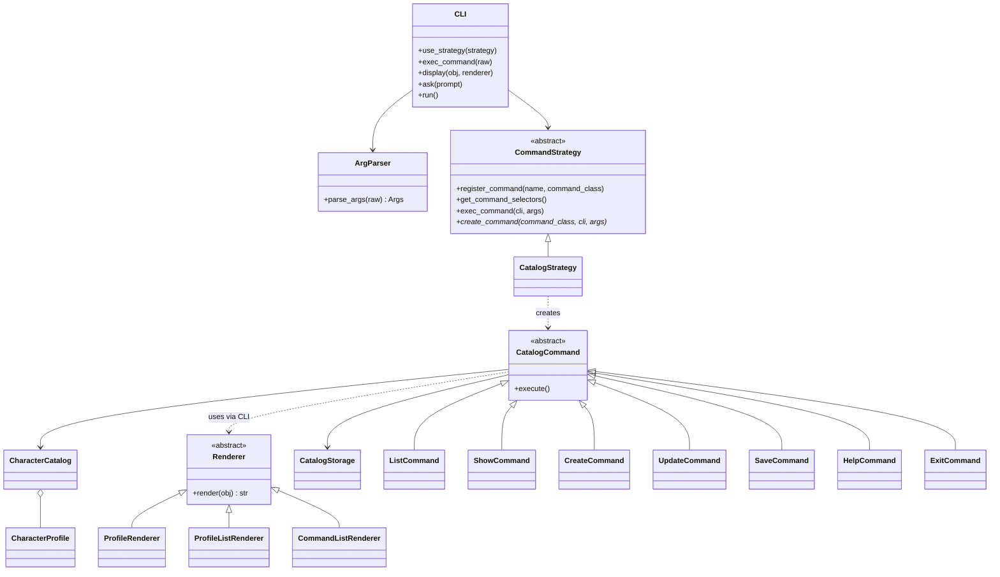
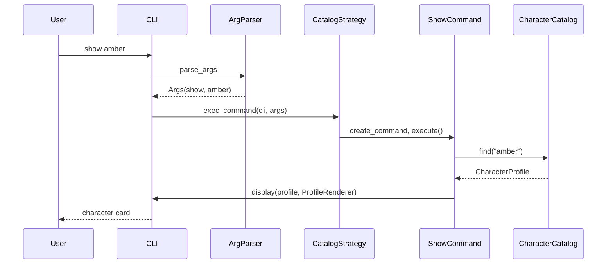

# Design Document: Character Catalog (Command Line Interface)

| | |
|---|---|
| **Author** | Dariia Voitenko, group KN-31, Optima College |
| **Course** | Object-Oriented Programming, Practical 13 |
| **Topic** | Topic 1: Character Catalog |
| **Status** | Implemented |

## 1. Introduction

The project is a console application that keeps a catalog of game characters.
A user can list all characters, look at one character in detail (including a link
to its artwork), create a new character through a dialog, and save the catalog
to disk.

This document describes the structure of the whole application and gives a detailed
description of its **command line interface (CLI)**, which is the part evaluated in
this practical. The CLI belongs to the *User Interface* category of the project.

## 2. Goals and Non-Goals

**Goals**

- Show the list of all available characters and refresh it from the data file.
- Show general information about a character, including a link to its graphics.
- Create a new character through a dialog.
- Save user-created data between runs.
- Keep the CLI replaceable: the same core must be usable from a future GUI.

**Non-goals**

- A graphical interface (planned as a later layer, see Rollout Plan).
- Downloading characters from the remote server (the server is unavailable, see Constraints).
- Multi-user access or a database.

## 3. Assumptions

- A single user works with the application at a time.
- Catalog size is small (tens of characters), so keeping it in memory is fine.
- JSON serialization is enough for persistence (as taught in the course).
- Python 3.9 or newer is installed.

## 4. Constraints and Limitations

- The remote service `genshin.jmp.blue` used in earlier practicals returned
  `HTTP 521 (Web server is down)` on 2026-10-30 and again on 2026-11-11.
  The catalog therefore ships with a built-in starter set of characters (stubs),
  which the assignment explicitly allows. Image links in the starter set point to the
  same service and will open only when it is back online.
- Character names are unique (case-insensitive, extra spaces ignored).
- The terminal must support UTF-8 and box-drawing characters.

## 5. Potential Solutions

| Option | Description | Decision |
|---|---|---|
| A | Put all logic into one `main` function with an `if/elif` chain | Rejected: hard to test and to extend |
| B | CLI facade with replaceable command sets and renderers | **Chosen** |
| C | Load characters from the remote API on every start | Rejected for now: the server is down; can be added later as another data source |

Option B follows the class diagram suggested in the practical: a `CLI` facade,
an `ArgParser`, a command strategy and a renderer. The renderer variant was chosen
where the CLI owns the rendering interface (`Renderer`), which keeps the objects
being displayed free from any console knowledge.

## 6. System Design and Architecture

### 6.1 Layers (N-tier architecture)

```
 Presentation layer          Business logic layer         Persistence layer
 ------------------          --------------------         -----------------
 cli/ (CLI, commands,   -->  core/ (CharacterProfile,     infra/ (CatalogStorage,
 renderers, graphic)         CharacterCatalog)            JSON file)

 The presentation layer depends on the core, never the other way round.
 The core knows nothing about the console or about files.
```

The entry point `catalog_app.py` is the only place where the layers are wired together
(composition root).

### 6.2 Terminology and components

| Component | Layer | Responsibility |
|---|---|---|
| `CLI` | presentation | Facade. Reads lines, hands them to the active command strategy, prints results. |
| `ArgParser`, `Args` | presentation | Splits a raw line into a command name and arguments. |
| `CommandStrategy` | presentation | Interface of a replaceable set of commands: register, list, execute by name. |
| `CatalogStrategy` | presentation | The concrete command set of the character catalog. |
| `CatalogCommand` and subclasses | presentation | One class per user action (`list`, `show`, `create`, `update`, `save`, `help`, `exit`). |
| `Renderer`, `ProfileRenderer`, `ProfileListRenderer`, `CommandListRenderer` | presentation | Turn an object into text for the console. |
| `CLIGraphic` | presentation | Console-specific elements: success/error messages, boxes, tables. |
| `Presenter`, `Displayer` | presentation / infra | Existing classes from earlier practicals: the only code that touches keyboard and screen. |
| `CharacterProfile` | core | Model of one character; validates its own data. |
| `CharacterCatalog` | core | Collection of profiles: add, find by name or number, export/import as plain data, unsaved-changes flag. |
| `CatalogStorage` | persistence | Reads and writes the catalog as a JSON file. |

### 6.3 Class diagram



### 6.4 Design patterns

| Pattern | Where | Why |
|---|---|---|
| **Facade** | `CLI` | External code uses three methods (`use_strategy`, `exec_command`, `display`); parsing, lookup and formatting stay hidden. |
| **Strategy** | `CommandStrategy`, `Renderer` | The command set and the output format can be replaced without changing `CLI`. |
| **Command** | `CatalogCommand` (reuses `Command` from earlier practicals) | Each user action is an object; adding a command does not touch existing ones. |
| **Template Method** | `CommandStrategy.exec_command` | Fixed order of steps (look up, create, execute); subclasses only decide how to create a command. |

### 6.5 Request flow



Pseudo code of the main loop:

```
while cli.running:
    raw = ask("catalog> ")                  # Ctrl+D / Ctrl+C here ends the program
    try:
        args = parse_args(raw)
        if command is registered: create command and execute it
        else: print "unknown command"
    except interrupted input:
        print "command interrupted"         # only the current command is cancelled
```

### 6.6 Data definition and persistence

The catalog is stored in `catalog.json`:

```json
{
    "characters": [
        {
            "name": "Amber",
            "title": "Outrider",
            "vision": "Pyro",
            "weapon": "Bow",
            "nation": "Mondstadt",
            "image_url": "https://genshin.jmp.blue/characters/amber/card"
        }
    ]
}
```

- `name` is mandatory and unique; all other fields are optional text.
- `image_url`, when present, must start with `http://` or `https://`.
- The persistence layer works with plain dictionaries, so it does not depend on core classes.
  The core exposes `get_all_data()` and `load_from_data()` (the same names as in `CharacterManager`).
- On the first run the file is created with the starter set. A damaged file is never
  overwritten: the application shows a warning and starts with the starter set.

### 6.7 Error handling

| Situation | Behaviour |
|---|---|
| Unknown command | Message and a hint to type `help` |
| `show` without or with an unknown name/number | Error message, nothing crashes |
| Empty or duplicate name, invalid link in `create` | Error message, catalog stays unchanged |
| File cannot be written | Error message; `exit` does not quit if the save requested there failed |
| Data file missing or damaged on `update` | Error message, current catalog is kept |
| Unsaved changes on `update` or `exit` | The user is asked to confirm |
| Input interrupted inside a dialog | Only that command is cancelled |

### 6.8 Performance, security, caching

Not applicable at this scale: the data set is tiny and everything is local.
The only external input is text typed by the user; it is validated before use
and is never executed.

## 7. Command Line Interface (detailed)

Start the application: `python3 catalog_app.py`

| Command | Usage | Result |
|---|---|---|
| `list` | `list` | Table of all characters with numbers |
| `show` | `show <name or number>` | Character card with the link to its image |
| `create` | `create` | Dialog asking name, title, vision, weapon, nation, image link |
| `update` | `update` | Re-reads the catalog from the file and shows the list |
| `save` | `save` | Writes the catalog to the file |
| `help` | `help` | Table of available commands |
| `exit` | `exit` | Quits; offers to save when there are unsaved changes |

Command names are case-insensitive. Messages are prefixed with `[Успіх]` or `[Помилка]`.

**Extending the CLI**

- New command: create a subclass of `CatalogCommand` and register it in `CatalogStrategy`.
- New command set (for example for a text game): subclass `CommandStrategy` and pass it to `cli.use_strategy(...)`.
- New output format: subclass `Renderer` and pass it to `cli.display(...)`.

## 8. API / Endpoints

There are no network endpoints. The public programming interface of the CLI is
`CLI.use_strategy(strategy)`, `CLI.exec_command(raw)` and `CLI.display(obj, renderer)`.
A future GUI would call the same core classes (`CharacterCatalog`, `CatalogStorage`)
and provide its own presentation layer.

## 9. Rollout Plan

1. **Phase 1 (this practical):** console catalog with local JSON storage and starter data.
2. **Phase 2:** add a data source that loads characters from the remote API
   (it fits in as another way of filling `CharacterCatalog`; the existing `WebApiClient` can be reused).
3. **Phase 3:** graphical interface as a second presentation layer on top of the same core.
4. **Phase 4 (optional):** text game as a second command set (`CommandStrategy`).

No data migration is needed: the file format has a single top-level key and can be extended.

## 10. Test Plan

- Automated tests are written with `pytest` and live in `tests/`.
- The console is replaced by a fake `Presenter` with scripted answers, so tests run without a keyboard and without the real file system outside of a temporary folder.
- Covered by tests: model validation, catalog rules (uniqueness, search, unsaved flag), storage (missing, damaged and unwritable files), parser, renderers and graphic helpers, every command including error paths, the dialog, the exit confirmation, restart persistence and application wiring.
- Manual check: run `python3 catalog_app.py`, execute `help`, `list`, `show amber`, `create`, `save`, `exit`, start again and run `list`.

Run all tests: `python3 -m pytest`

## 11. Appendix

- Lecture 10 (project design) and Lectures 9 to 10 of the course: behavioural patterns, N-tier architecture.
- Practical 13 assignment: command line interface of the application.

## 12. Review Sign-Off

| Role | Name | Date |
|---|---|---|
| Reviewer | | |
